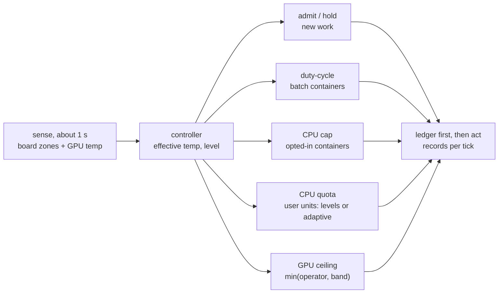
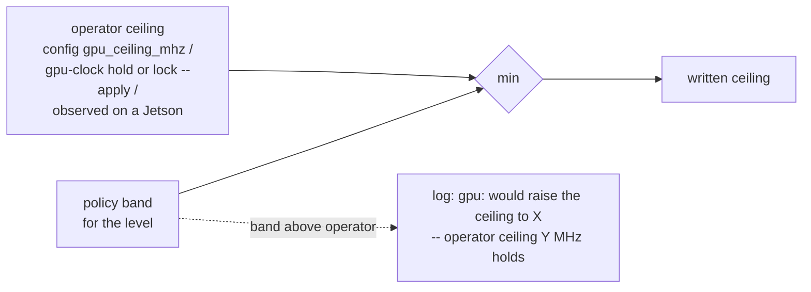
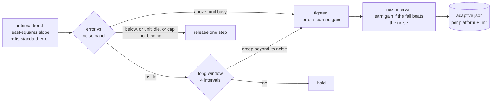
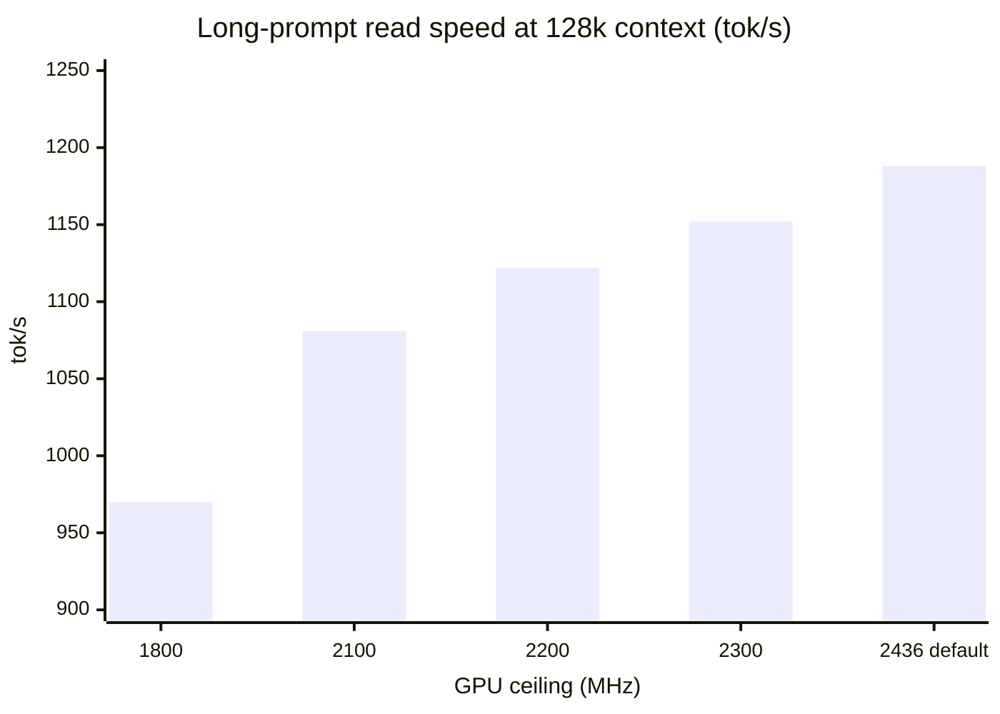
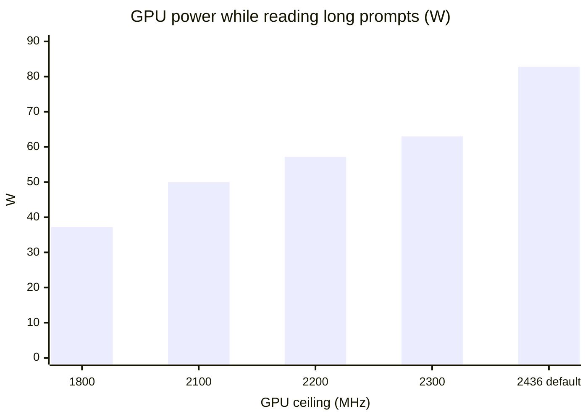
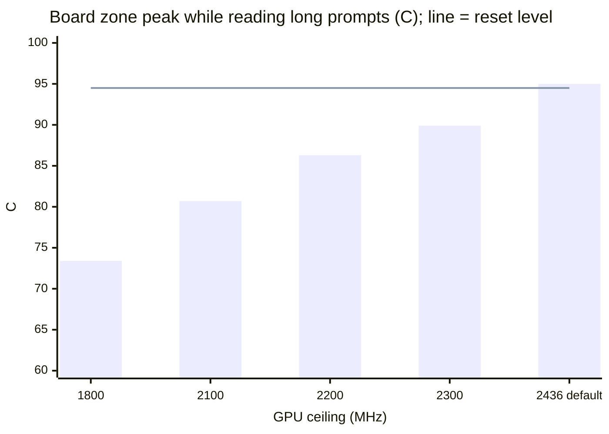
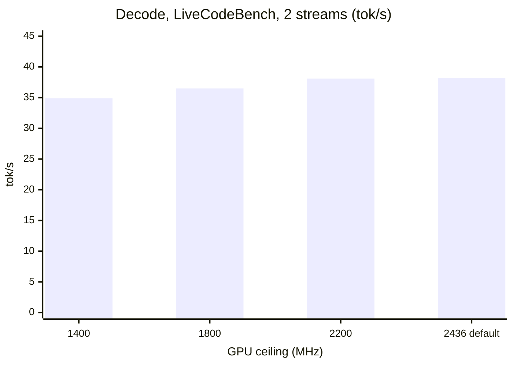
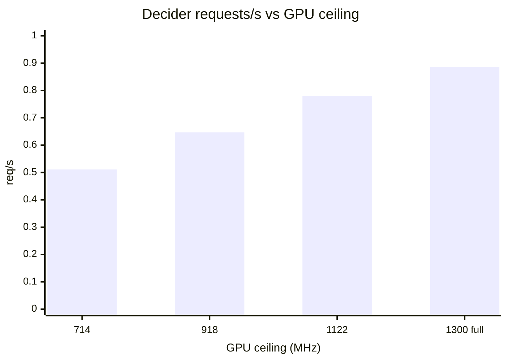
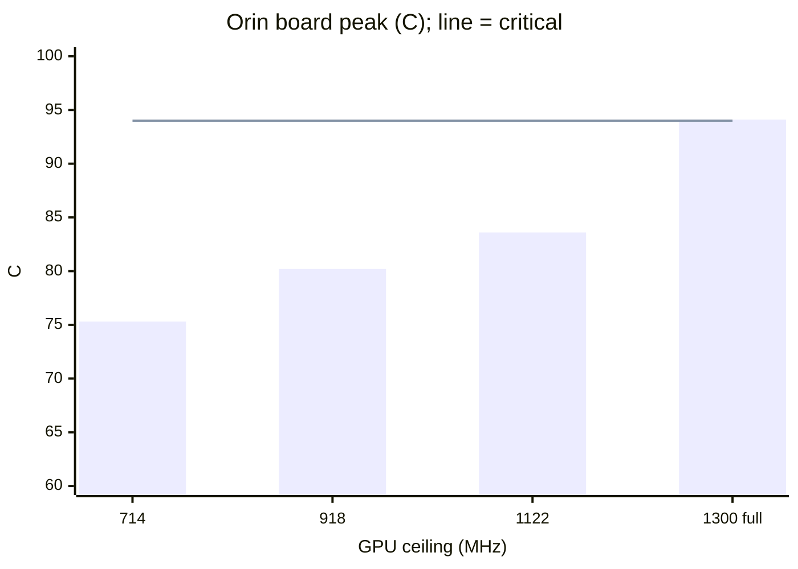
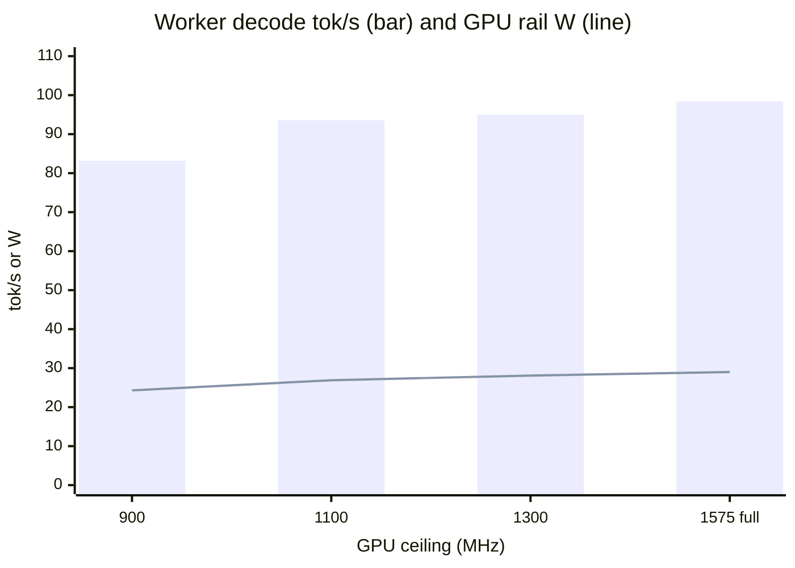

# heat-governor

Keeps machines running heavy AI work without thermal resets, while losing as
little throughput as possible. One daemon per host senses the thermal zones
about once a second, tells clients when to hold new work, duty-cycles and
CPU-caps the containers that opt in, and records each run so the next one is
tuned better.

It was built after a DGX Spark hard-reset twice in one day under long-context
LLM decode: the hottest ACPI zone reached ~95 C while the GPU sat at ~80 C,
and the zone moved up to 5 C in two seconds. See
[`docs/HANDOFF-2026-10-23.md`](docs/HANDOFF-2026-10-23.md).

`heat-governor` is also an [AgentCulture](https://github.com/agentculture)
mesh agent with an agent-first CLI. The runtime package has no third-party
dependencies.

## Quickstart

```bash
uv tool install heat-governor     # or, from a checkout: uv sync && uv run heat-governor ...
heat-governor capabilities        # what this host lets us read and change
heat-governor sense               # one reading of every zone
heat-governor run --once          # one dry-run tick: what it would do right now
heat-governor run                 # the daemon, signalling and recording only
heat-governor run --apply         # ...and governing the containers that opted in
```

Install it as a user service:

```bash
heat-governor unit -- --apply > $XDG_CONFIG_HOME/systemd/user/heat-governor.service
systemctl --user daemon-reload && systemctl --user enable --now heat-governor
loginctl enable-linger "$USER"
```

## How it governs



| Level | When (effective temperature) | New work | Batch containers | CPU caps / unit quota / GPU step |
|---|---|---|---|---|
| cool | below warm | admitted, full | running | none (operator ceiling only) |
| warm | warm to hot | admitted, half | paused part of each 2 s | first step |
| hot | hot to critical | held | paused most of each period | lower step |
| critical | at or above critical | held | paused | lowest step |

| Rule | Value |
|---|---|
| Inputs | hottest board zone; GPU temp on its own bands (Spark 82 / 87 / 91 C); the one closer to its limit governs |
| Rising | lookahead on the rate; levels rise at once |
| Falling | below the threshold minus hysteresis, for the dwell time |
| Sensors lost | treated as hot |
| Container opt-in | label `heat-governor.role=batch` or `serving` (+ `heat-governor.cpu-cap=true`) |
| Never | undoes a pause it did not make; touches power modes or fans |

| Platform | warm / hot / critical | GPU steps | Source |
|---|---|---|---|
| DGX Spark (GB10) | 88 / 91.5 / 93 C (ACPI zones) | operator ceiling **2200 MHz** (law); 1800 / 1400 above warm | measured (resets at about 94.5-95 C; clock sweep 2026-10-24) |
| Jetson AGX Thor | 95 / 100 / 104 C | 1300 / 1000 MHz | limits declared; clock sweep 2026-10-24: no default ceiling |
| Jetson AGX Orin | 85 / 90 / 94 C | **1122 MHz at 85 C, 918 MHz at 88 C** | limits declared; GPU steps measured 2026-10-24 |
| anything else | lowest critical trip minus 15 C | none | derived |

### The operator's ceiling is law



| Case | What the daemon does |
|---|---|
| heat wants a lower ceiling | goes below the operator's |
| heat wants a higher one, or none | keeps the operator's and logs "would raise" (state: `gpu_held_by_operator`) |
| exit, `gpu_clock` off, crash recovery | restores the operator's, never a reset |
| hand lock on a Jetson | read back, held as `observed` |
| hand lock on a DGX Spark | invisible to the hardware: declare it, or use `gpu-clock lock --apply` (records a hold) |
| a container's own CPU limit is tighter than the band | never raised; logged |

Contract: [`docs/contracts/gpu-clock.md`](docs/contracts/gpu-clock.md).

### Adaptive user-unit quota

Opt-in (`[[units]]`, e.g. `app.slice`, where interactive sessions and their
test runs live). Every change is `systemctl --user set-property --runtime`, so
a reboot drops it.



| Box (live test, 2026-10-24) | Learned gain (C/s per CPU) | Noise band (C/s) |
|---|---|---|
| DGX Spark | about 0.21 | 0.03-0.24 |
| Thor | about 0.14 | 0.02-0.14 |
| spark2 | 0.07 | about 0.07 |
| Orin | 0.02-0.04 | 0.01-0.02 |

Contract: [`docs/contracts/user-units.md`](docs/contracts/user-units.md).
Evidence: [`docs/evidence/2026-10-24-adaptive-units-live.md`](docs/evidence/2026-10-24-adaptive-units-live.md).

## Measured: GPU clock ceilings (2026-10-24)

| Box | Workload | Decision |
|---|---|---|
| DGX Spark, spark2 | decode, prefill up to 128k, LoRA fine-tune | operator ceiling **2200 MHz** |
| Jetson AGX Thor | worker decode (Qwen3.6-35B-A3B, DFlash) | no ceiling; heat steps only |
| Jetson AGX Orin | decider (Clef 27B W4A16), mostly prefill | no ceiling; measured steps 1122 / 918 MHz |

### DGX Spark









| Workload (Spark / spark2) | 1800 | 2100 | **2200** | 2300 | default |
|---|---|---|---|---|---|
| decode tok/s (Spark) | 36.5 | | **38.1** | | 38.2 |
| decode GPU W (Spark) | 17.0 | | **24.2** | | 37.5 |
| decode tok/s (spark2) | | 39.0 | **39.1** | 39.2 | |
| decode GPU W (spark2) | | 20.4 | **22.4** | 24.6 | |
| prefill tok/s, 32k | 1749 | 1902 | **1946** | 1982 | 2005 |
| prefill tok/s, 128k | 970 | 1081 | **1122** | 1152 | 1188 |
| prefill GPU W | 37.2 | 50.0 | **57.2** | 63.0 | 82.8 |
| board z0 peak, prefill (C) | 73.4 | 80.7 | **86.3** | 89.9 | 95.0 |
| LoRA 300 steps, s | 63.9 | | **57.8** | | 60.1 / 54.8 |
| LoRA GPU W | 30.8 | | **47.3** | | 63.5 / 67.4 |

### Jetson AGX Orin (decider)





### Jetson AGX Thor (worker)



Evidence: [`docs/evidence/2026-10-24-gpu-clock-ceiling-spark.md`](docs/evidence/2026-10-24-gpu-clock-ceiling-spark.md),
[`docs/evidence/2026-10-24-gpu-clock-ceiling-jetsons.md`](docs/evidence/2026-10-24-gpu-clock-ceiling-jetsons.md).

## Configure and tune

Everything above is a setting in one TOML file that a running daemon re-reads
within about 2 s. A bad edit is rejected and the last good settings stay.

```bash
heat-governor config init --write     # $XDG_CONFIG_HOME/heat-governor/config.toml from the built-in profile
$EDITOR $XDG_CONFIG_HOME/heat-governor/config.toml
heat-governor config check            # every problem at once; unknown keys are errors
heat-governor config show             # what is in force
heat-governor gpu-clock helper        # the root helper + sudoers line for GPU clocks
```

## For other tools

- Label your containers, or read the signal before starting new work:
  `heat-governor wait --timeout 1800 && next-job`, or in Python
  `heat_governor.client.wait()` / `client.Gate(4).slot()`.
- The JSON contract: [`docs/contracts/state.md`](docs/contracts/state.md).
- The guide for lobes, sparkrun, mjolnir and scripts:
  [`docs/integration.md`](docs/integration.md).

## CLI

| Verb | What it does |
|------|--------------|
| `sense` | Read every zone, fan and the GPU once. |
| `capabilities` | What this host lets heat-governor read and change, and the active profile. |
| `run` | The daemon (dry-run without `--apply`; `--once` for one tick). |
| `state` | Read the published admission state (local file or `--source URL`). |
| `wait` | Block until new work is admitted; exit 3 on `--timeout` while held. |
| `report` | Reboots seen in the records, and what preceded each. |
| `replay <trace>` | Run the controller over a recorded trace to tune a profile. |
| `sensors` | Every sensor separately over a window: min, mean, p95, max, seconds above a threshold. |
| `unit` | Print a systemd user unit. |
| `config overview\|path\|show\|init\|check` | The config file a running daemon re-reads. |
| `gpu-clock overview\|status\|helper\|lock\|reset\|hold\|release` | The GPU clock ceiling (root helper); `hold`/`release` declare the operator's ceiling (law). |
| `whoami`, `learn`, `explain <path>`, `overview`, `doctor`, `cli overview` | Agent verbs. |

Every command supports `--json`. Results go to stdout and errors/diagnostics
to stderr. Exit codes: `0` success, `1` user error, `2` environment error,
`3` `wait` timed out while held.

## Development

```bash
uv sync
uv run pytest -n auto
uv run teken cli doctor . --strict    # the agent-first rubric gate CI runs
```

## Agent harnesses

Four harnesses can work in this repo. Each reads exactly one root prompt file,
and there is deliberately **no `AGENTS.md`** acting as a shared base:

| Harness | File(s) |
|---------|---------|
| Claude Code | [`CLAUDE.md`](CLAUDE.md) (the fullest write-up; read it first) |
| Pi / associate | [`AGENTS.override.md`](AGENTS.override.md) + [`.pi/SYSTEM.md`](.pi/SYSTEM.md) |
| colleague | [`AGENTS.colleague.md`](AGENTS.colleague.md) |
| Qwen Code | [`QWEN.md`](QWEN.md) |

`culture.yaml` declares `backend: claude`, so `CLAUDE.md` is the mesh
resident's prompt. That declaration does not stop you running any of the four
harnesses interactively. See
[`docs/harness-selection.md`](docs/harness-selection.md) and
[`docs/automation-contract.md`](docs/automation-contract.md).
`scripts/harness-smoke.py` checks that all four configs are correct.

The guildmaster skill kit is vendored under `.claude/skills/`, cited
verbatim. Its provenance is recorded in
[`docs/skill-sources.md`](docs/skill-sources.md).

## Contributing

- Every PR bumps the version (`version-bump` skill). CI's `version-check` job
  blocks the merge otherwise.
- CI runs pytest with coverage and SonarCloud, black, isort, flake8, bandit,
  markdownlint, the secret scan, the agent-first rubric gate, and the
  per-harness smoke check.
- A merge to `main` that touches `pyproject.toml` or `heat_governor/`
  publishes to PyPI via Trusted Publishing. Such PRs publish a dev build to
  TestPyPI.

## The `gate` section

`culture.yaml` carries a top-level `gate` section that declares how to set up
and test this repo, so tooling such as a PR-fixer needs no per-repo knowledge:

```yaml
gate:
  setup:
  - [uv, sync]
  test:
  - [uv, run, pytest, -n, auto]
```

`setup` and `test` are each a list of commands. Each command is an argv list
(never a shell string), run in order from the repo root. Culture's loader
ignores unknown top-level keys, so the section is safe alongside `agents`.

## License

Apache 2.0 — see [`LICENSE`](LICENSE).
